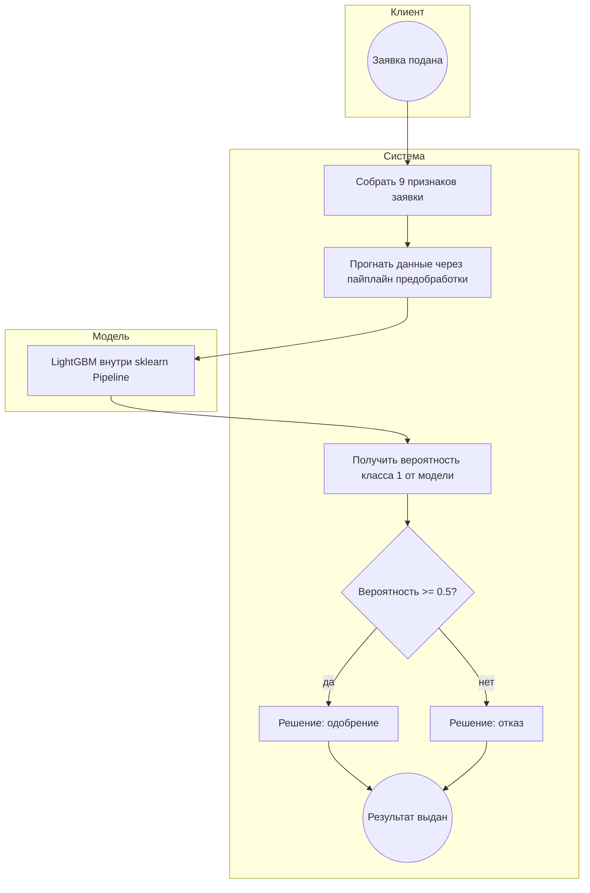

# Место модели в процессе: предсказание одобрения кредита

Схема в нотации BPMN, передана через Mermaid `flowchart` (GitHub отрисовывает её
прямо на странице). Условные обозначения: круги — события, прямоугольники — задачи,
ромбы — развилки, подграфы (subgraph) — участники процесса.

## Схема

## Что происходит на схеме

1. **Событие-старт** — клиент подаёт кредитную заявку (круг «Заявка подана»).
2. **Сбор признаков** — система собирает 9 признаков заявки: 5 числовых
   (`person_income`, `person_emp_length`, `loan_amnt`, `loan_int_rate`,
   `loan_percent_income`) и 4 категориальных (`person_home_ownership`, `loan_intent`,
   `loan_grade`, `cb_person_default_on_file`).
3. **Предобработка** — признаки проходят через sklearn `Pipeline`: Box-Cox для
   `person_income` и Ordinal Encoding для категориальных (источник:
   `src/step7_pipeline/pipeline_cv.py`).
4. **Модель** — LightGBM (`LGBMClassifier`) выдаёт вероятность класса 1 (одобрение).
5. **Развилка** — по порогу 0.5 принимается решение: одобрение или отказ.
6. **Событие-конец** — результат выдан.

## Ответы на вопросы задания

**Какую задачу в процессе решает модель.** Модель решает задачу бинарной классификации:
по признакам заявки она относит её к одному из двух классов — одобрение (1) или отказ (0) —
и возвращает вероятность класса 1.

**Почему для этой задачи целесообразно использовать ML.** Решение зависит сразу от
нескольких разнородных признаков (сумма, ставка, доход, грейд, история дефолта), связь
между которыми нелинейная (это показано на шаге 3 проекта 19 методами анализа зависимостей).
Ручное правило на таком наборе признаков быстро перестанет работать, а модель обучается
на данных и обобщает эти зависимости. Классификация по табличным признакам — типовая
задача, которую хорошо решают градиентные бустинги (LightGBM).

**Какие данные поступают на вход модели.** Девять признаков заявки, перечисленных выше.
`person_income` перед подачей в модель преобразуется Box-Cox-трансформацией.

**Как результат модели используется дальше в процессе.** Вероятность класса 1 сравнивается
с порогом 0.5 и превращается в решение: одобрить заявку или отказать. Дальше это решение
возвращается в бизнес-процесс обработки заявки.
