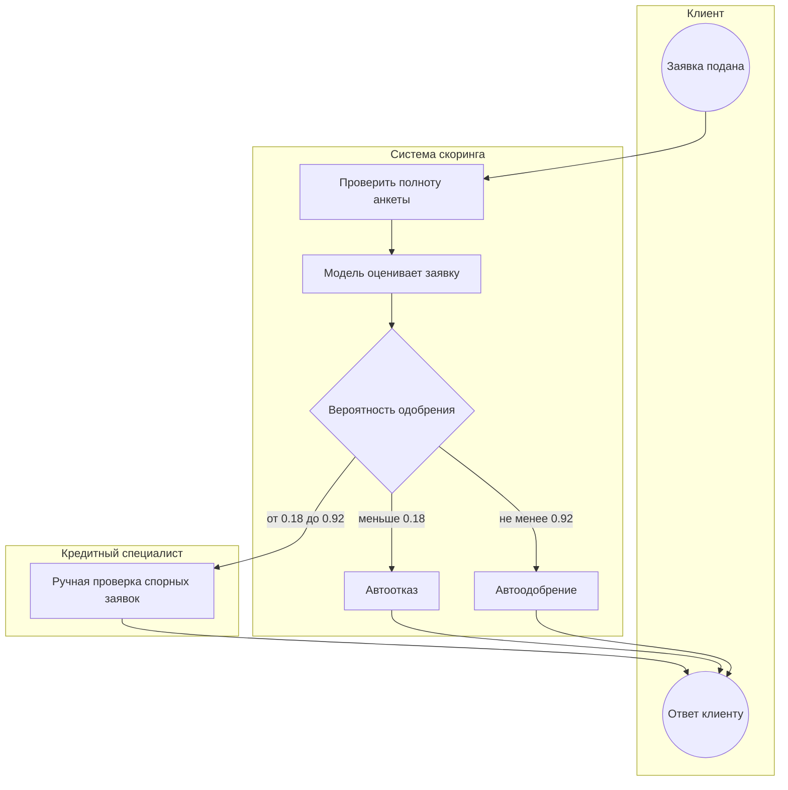

# Место модели в процессе обработки кредитной заявки

Схема в нотации BPMN, передана через Mermaid `flowchart` (GitHub отрисовывает её
прямо на странице). Условные обозначения: круги — события, прямоугольники — задачи,
ромбы — развилки, подграфы (subgraph) — участники процесса.

Модель — это одна из задач внутри системы скоринга, а не отдельный участник.

## Схема

## Что происходит на схеме

1. **Клиент подаёт заявку** (событие-старт).
2. **Система проверяет полноту анкеты** — все ли нужные данные заполнены.
3. **Модель оценивает заявку** — по признакам заявки выдаёт вероятность одобрения
   (вероятность класса 1).
4. **Развилка по правилу кредитной политики** — вероятность сравнивается с границами
   зон (0.18 и 0.92):
   - не меньше 0.92 — автоодобрение;
   - меньше 0.18 — автоотказ;
   - от 0.18 до 0.92 — ручная проверка кредитным специалистом.
5. **Кредитный специалист** рассматривает только спорные заявки и принимает решение.
6. **Клиент получает ответ** (событие-конец).

## Ответы на вопросы задания

**Какую задачу в процессе решает модель.** Модель решает задачу бинарной
классификации: по признакам заявки она оценивает вероятность одобрения и на её основе
заявка направляется в одну из трёх зон решения — автоодобрение, автоотказ или ручная
проверка.

**Почему для этой задачи целесообразно использовать ML.** Решение зависит от
нескольких разнородных признаков (сумма, ставка, доход, грейд, история дефолта),
связь между которыми нелинейная. Это показано на шаге 3 проекта, где зависимости
изучались 19 методами. Ручное правило на таком наборе признаков быстро перестанет
работать, а модель обучается на данных и обобщает эти зависимости. Классификация по
табличным признакам — типовая задача, которую хорошо решает градиентный бустинг
(LightGBM).

**Какие данные поступают на вход модели.** Девять признаков заявки: 5 числовых
(`person_income`, `person_emp_length`, `loan_amnt`, `loan_int_rate`,
`loan_percent_income`) и 4 категориальных (`person_home_ownership`, `loan_intent`,
`loan_grade`, `cb_person_default_on_file`).

**Как результат работы модели используется дальше в процессе.** Вероятность одобрения
сравнивается с границами зон 0.18 и 0.92. Уверенные заявки решаются автоматически,
спорные попадают кредитному специалисту. Так модель не принимает решение «да/нет»
сама по единственному порогу, а передаёт человека туда, где модель не уверена.

## Как выбраны границы зон

Границы рассчитаны по данным на out-of-fold вероятностях модели (каждая вероятность
получена моделью, которая не видела эту заявку). Подбор на сетке порогов с шагом 0.01,
результаты в `results/step8_decision_zones/`.

Сетка вариантов: A — допустимая доля плохих заявок среди автоодобренных, B —
допустимая доля потерянных хороших заявок от всех хороших. Все девять вариантов:

| A | B | Нижняя | Верхняя | Автоодобрение | Ручная | Автоотказ | Без человека |
|---|---|---|---|---|---|---|---|
| 5% | 2% | 0.08 | 0.92 | 10.2% | 43.1% | 46.8% | 56.9% |
| 5% | 5% | 0.18 | 0.92 | 10.2% | 25.6% | 64.2% | 74.4% |
| 5% | 10% | 0.33 | 0.92 | 10.2% | 14.1% | 75.8% | 85.9% |
| 10% | 2% | 0.08 | 0.80 | 11.7% | 41.6% | 46.8% | 58.4% |
| 10% | 5% | 0.18 | 0.80 | 11.7% | 24.1% | 64.2% | 75.9% |
| 10% | 10% | 0.33 | 0.80 | 11.7% | 12.6% | 75.8% | 87.4% |
| 15% | 2% | 0.08 | 0.72 | 12.9% | 40.4% | 46.8% | 59.6% |
| 15% | 5% | 0.18 | 0.72 | 12.9% | 22.9% | 64.2% | 77.1% |
| 15% | 10% | 0.33 | 0.72 | 12.9% | 11.4% | 75.8% | 88.6% |

**Выбран рабочий вариант: A = 5%, B = 5%.** Границы: нижняя 0.18, верхняя 0.92.

Обоснование выбора:

- A влияет только на зону автоодобрения (10–13% заявок). Рост A с 5% до 15% добавляет
  лишь 1.6–2.7% автоматизации, но увеличивает число одобренных плохих заявок в 3.8 раза
  (296 при A = 5% против 1 121 при A = 15%). Поэтому A = 5%.
- B определяет нагрузку на ручную проверку. B = 5% — компромисс: 74.4% заявок решаются
  автоматически, на ручную проверку уходит 25.6%, при этом теряется 404 хороших заявки
  (4.84% от всех хороших).
- Реальных цен ошибок в данных нет, поэтому выбор обоснован логикой, а не расчётом
  прибыли.

## Почему три зоны, а не один порог

Модель выдаёт вероятность, а не готовый ответ «да/нет». Один порог заставлял бы
одновременно выбирать и долю ошибок автоотказа, и долю ошибок автоодобрения — при
сильном дисбалансе классов (класс 1 около 14%) это приводит к вырожденным правилам.
Три зоны разделяют эти две цены ошибки: верхняя граница ограничивает одобренные плохие
заявки, нижняя — потерянные хорошие. Уверенные случаи решаются автоматически, а
спорные уходят человеку, который принимает решение в сложных ситуациях.
