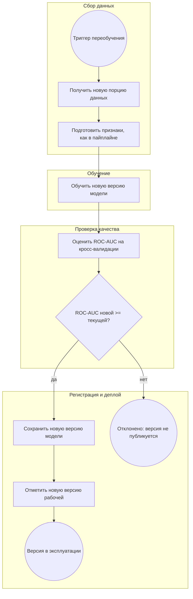

# Процесс автоматического переобучения модели

Схема в нотации BPMN, передана через Mermaid `flowchart` (GitHub отрисовывает её
прямо на странице). Условные обозначения: круги — события, прямоугольники — задачи,
ромбы — развилки, подграфы — участники процесса.

Схема построена на компонентах, которые уже есть в проекте: пайплайн обучения
(`src/step7_pipeline/`), файловое хранение результатов (`results/`), Docker, CI. В описании
каждого этапа честно отмечено, что уже реализовано, а что описано как целевой процесс.

## Схема

## Описание этапов

**1. Триггер запуска переобучения (событие).** Запускает цикл. Триггерами могут быть:
появление новой порции данных, ухудшение метрик на свежих данных (дрейф) или запуск по
расписанию. В текущем проекте автоматического триггера нет — это целевой процесс;
сейчас переобучение запускается вручную.

**2. Получение и подготовка новых данных (задачи).** Берётся новая порция заявок и
приводится к тем же 9 признакам, что и в обучении (`person_income` через Box-Cox,
категориальные через Ordinal Encoding). Подготовка признаков реализована внутри
sklearn `Pipeline` (`src/step7_pipeline/pipeline_cv.py`).

**3. Обучение новой версии (задача).** На новых данных обучается новая версия той же
модели LightGBM с теми же гиперпараметрами. Этот этап реализован: `create_pipeline()` +
`run_cross_validation()` в `src/step7_pipeline/pipeline_cv.py`.

**4. Проверка качества (задача + развилка).** Новая версия оценивается на 5-Fold
кросс-валидации по ROC-AUC. Реализовано: `run_cross_validation()` считает ROC-AUC,
accuracy, precision, recall, f1 по фолдам и среднее.

**5. Решение о возможности публикации (развилка).** Сравнивается ROC-AUC новой версии
с ROC-AUC текущей рабочей версии. Если новая версия не хуже — публикуем; если хуже —
отклоняем. Автоматическое сравнение в коде не реализовано, описано как целевой процесс;
на защите сравнение выполняется вручную по метрикам в таблице версий.

**6. Регистрация новой версии (задача).** Новая версия сохраняется файлом в `results/models/`
с номером версии, рядом в таблицу версий записываются её метрики. Автоматизация не реализована —
описано как целевой процесс.

**7. Деплой (задача).** Рабочая версия отмечается в таблице версий, после чего именно она
считается действующей. Автоматический деплой в продакшн (например, через Docker-образ с новой
моделью) — целевой процесс, описан, но не автоматизирован.

**8. Действия при неуспешном прохождении проверок (событие).** Если новая версия хуже —
она не публикуется; в таблице версий остаётся запись с метриками, по которым видно,
почему версия отклонена, а в эксплуатации остаётся прежняя рабочая версия. Дальше
разбираются причины ухудшения (данные, дрейф, ошибки подготовки).

## Что реализовано, а что описано как целевой процесс

- **Реализовано сейчас:** подготовка признаков и обучение (step7 Pipeline), оценка
  ROC-AUC кросс-валидацией, сохранение графиков и таблиц в `results/`, проверки CI
  (ruff, pytest) и сборка Docker.
- **Целевой процесс (описано, автоматизации нет):** автоматический триггер по расписанию
  или дрейфу, автоматическое сравнение новой версии с текущей, таблица версий моделей
  в `results/models/`, автоматический деплой новой версии.
