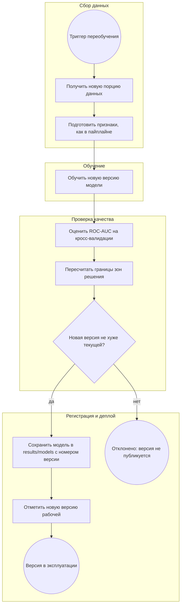

# Процесс автоматического переобучения модели

Схема в нотации BPMN, передана через Mermaid `flowchart` (GitHub отрисовывает её
прямо на странице). Условные обозначения: круги — события, прямоугольники — задачи,
ромбы — развилки, подграфы — участники процесса.

Версионирование модели — файловое: новая модель сохраняется файлом в
`results/models/` с номером версии, рядом в таблицу версий записываются её метрики,
рабочая версия отмечается в той же таблице. В описании каждого этапа отмечено, что
уже реализовано в проекте, а что описано как целевой процесс.

## Схема

## Описание этапов

**1. Триггер запуска переобучения (событие).** Запускает цикл. Триггерами могут быть:
появление новой порции данных, ухудшение метрик на свежих данных (дрейф) или запуск по
расписанию. В текущем проекте автоматического триггера нет — это целевой процесс;
сейчас переобучение запускается вручную.

**2. Получение и подготовка новых данных (задачи).** Берётся новая порция заявок и
приводится к тем же 9 признакам, что и в обучении (`person_income` через Box-Cox,
категориальные через Ordinal Encoding). Подготовка признаков реализована внутри
sklearn `Pipeline` (`src/step7_pipeline/pipeline_cv.py`).

**3. Обучение новой версии (задача).** На новых данных обучается новая версия той же
модели LightGBM с теми же гиперпараметрами. Реализовано: `create_pipeline()` +
`run_cross_validation()` в `src/step7_pipeline/pipeline_cv.py`.

**4. Проверка качества (задача).** Новая версия оценивается на 5-Fold кросс-валидации
по ROC-AUC. Реализовано: `run_cross_validation()` считает ROC-AUC, accuracy, precision,
recall, f1 по фолдам и среднее.

**5. Пересчёт границ зон решения (задача).** Для новой модели заново считаются границы
трёх зон решения (шаг 8), потому что вероятности у новой модели другие и старые границы
к ней не подходят. Реализовано: `src/step8_decision_zones/decision_zones.py`.

**6. Решение о возможности публикации (развилка).** Сравнивается ROC-AUC новой версии
с ROC-AUC текущей рабочей версии. Если новая не хуже — публикуем; если хуже — отклоняем.
Автоматическое сравнение в коде не реализовано — это целевой процесс.

**7. Регистрация новой версии (задача).** Новая модель сохраняется файлом в
`results/models/` с номером версии, рядом в таблицу версий записываются её метрики и
границы зон. Автоматизация не реализована — целевой процесс.

**8. Деплой (задача).** Рабочая версия отмечается в таблице версий, после чего именно
она считается действующей. Автоматический деплой (например, через Docker-образ с новой
моделью) — целевой процесс, описан, но не автоматизирован.

**9. Действия при неуспешном прохождении проверок (событие).** Если новая версия хуже —
она не публикуется; в таблице версий остаётся запись с метриками, по которым видно,
почему версия отклонена, а в эксплуатации остаётся прежняя рабочая версия. Дальше
разбираются причины ухудшения (данные, дрейф, ошибки подготовки).

## Что реализовано, а что описано как целевой процесс

- **Реализовано сейчас:** подготовка признаков и обучение (step7 Pipeline), оценка
  ROC-AUC кросс-валидацией, расчёт границ зон (шаг 8), сохранение графиков и таблиц в
  `results/`, проверки CI (ruff, pytest) и сборка Docker.
- **Целевой процесс (описано, автоматизации нет):** автоматический триггер по
  расписанию или дрейфу, автоматическое сравнение новой версии с текущей, таблица
  версий моделей в `results/models/`, автоматический деплой новой версии.
